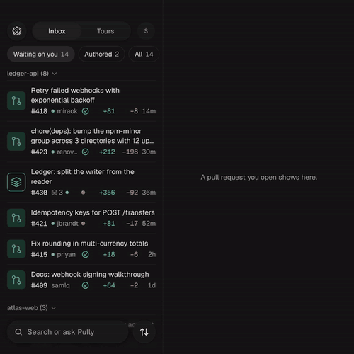
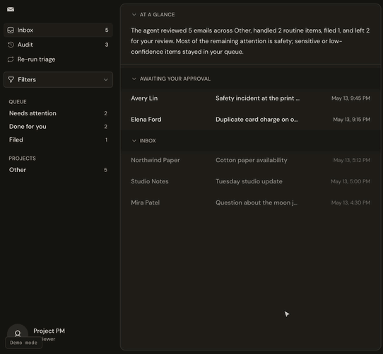

# Octavian Tocan

Product & Design Engineer in Zaragoza, Spain. I build products end to end: deciding what to make, designing it, and shipping it.

**Selected work**

<table>
  <tr>
    <td align="center"></td>
    <td align="center"></td>
    <td align="center"></td>
  </tr>
  <tr>
    <td align="center"><b>Pully</b></td>
    <td align="center"><b>Inventory</b></td>
    <td align="center"><b>Agentic Inbox</b></td>
  </tr>
</table>

- [Agentic Inbox](https://agentic-inbox.octaviantocan.com): an AI agent sorts a shared inbox; sensitive mail always waits for a human, and every action can be reviewed and undone.
- [Pully](https://github.com/OctavianTocan/Pully): a native Android app for reviewing pull requests, with two panes on foldables. [Design book](https://www.figma.com/design/caabrz5iXYp6VjPbaRm7wh/Pully-%E2%80%94-Kotlin-UI-Book)
- [Inventory](https://github.com/OctavianTocan/inventory): a private library for everything you save, where every save feels like loot. An Android app on a Rust server on Cloudflare Workers. [Design book](https://www.figma.com/design/XOmC8KfGVurXlA7iPFXEbe/Inventory-%E2%80%94-Android-Design-Book)
- [octaviantocan.com](https://octaviantocan.com): my site and its interactive details. [Design book](https://www.figma.com/design/2c2xygZlDW76eHUDO9EvaS/Octavian-Tocan-%E2%80%94-Website-Design-Book)

**Design books**

I keep one Figma file per product, in the same format: foundations, every component and its states, full-screen examples, and the decisions behind them. [See them all](https://designs.magicpath.ai/v1/wildly-shadow-3296), including the [design system I built at Ojin](https://www.figma.com/design/1AU4IhFEsgeMISWyDniBBk/Ojin-%E2%80%94-Web-Design-Book).

Also building [Pawrrtal](https://github.com/OctavianTocan/pawrrtal-ai), my own AI agent workspace.

[Site](https://octaviantocan.com) · [Design books](https://designs.magicpath.ai/v1/wildly-shadow-3296) · [LinkedIn](https://www.linkedin.com/in/octavian-tocan/) · contact@octaviantocan.com
